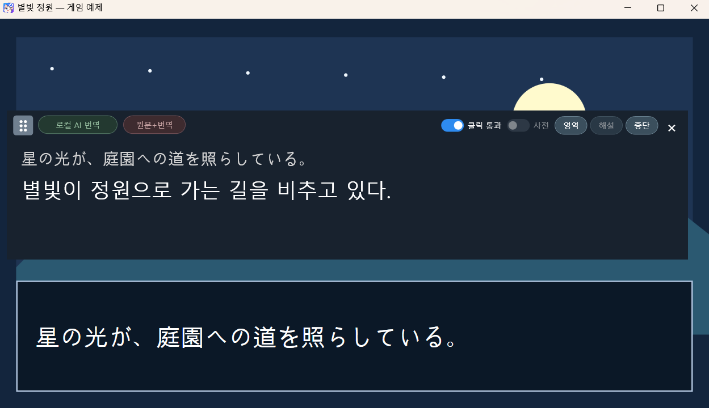
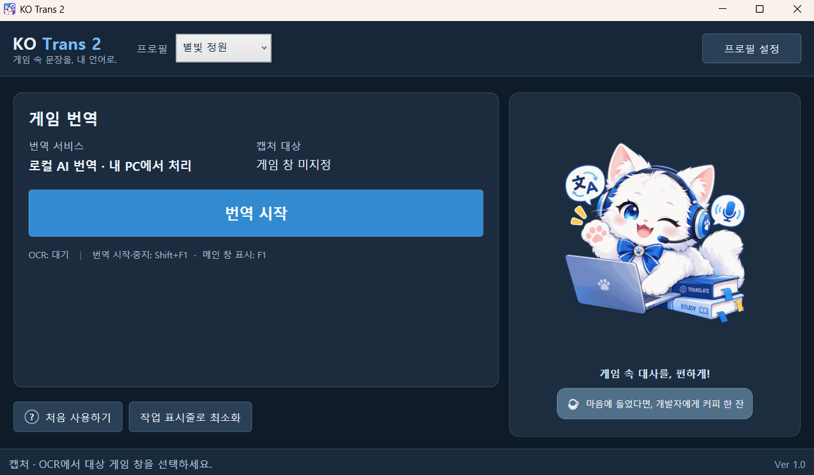

# KO Trans 2

**게임 속 문장을, 내 언어로.**

KO Trans 2는 영어·일본어 게임 화면의 글자를 OCR로 읽고 한국어로 번역해 자막창에 표시하는 Windows 앱입니다. PC에서 실행하는 로컬 AI와 사용자가 선택한 외부 번역 서비스를 지원합니다.

## 주요 기능

- 영어·일본어 PaddleOCR, 한국어 번역 자막, 이미지와 클립보드 입력
- 게임별 프로필과 게임 창 기준 대사 영역 저장
- 화면 자동 인식 또는 마우스·키보드·게임패드 입력으로 인식 시작
- PaddleOCR v6 Medium(기본), v5(속도 우선), v5 검출 + v6 인식(균형형) 선택
- 일본어 세로쓰기 인식. 모델과 글꼴에 따라 정확도가 달라집니다.
- 캐릭터 사전 JSON으로 인물 이름과 관계를 지원되는 번역 서비스에 전달
- 자막의 원문 단어를 클릭해 사전 검색, 지원되는 AI로 문장 해설과 어휘 학습
- **처음 사용하기** 마법사와 앱에서 여는 오프라인 도움말

## 다운로드 및 설치

지원 대상은 **Windows 10/11 x64**입니다. 공개 ZIP은 발행 후 [GitHub Releases](https://github.com/breadu/ko_trans2/releases)에서 내려받을 수 있습니다.

1. ZIP 전체를 쓰기 가능한 새 폴더에 풉니다.
2. 압축을 푼 폴더에서 **KoTrans2.exe**를 실행합니다. 함께 풀린 OCR 모델, 일본어 사전, 도움말과 실행 구성요소는 같은 폴더 구조로 두세요.
3. 메인 화면에서 **처음 사용하기**를 선택합니다.

배포 폴더에 .NET 런타임이 포함됩니다. 내장 로컬 AI 번역 모델은 처음 사용할 때 설치 동의를 받은 뒤 인터넷으로 내려받습니다.

## 첫 게임 번역

1. 프로그램을 열고 게임 프로필을 만든 뒤 원문 언어를 선택합니다.
2. 게임에서 대사를 띄운 뒤 **게임 창 연결**로 창을 선택하고 대사가 표시되는 영역을 지정합니다.
3. 번역 서비스를 고르고 **번역 시작**을 눌러 한국어 자막을 확인합니다.

[화면으로 따라 하는 빠른 시작](docs/help/quick-start.html)

## 번역 서비스

| 서비스 | 사용 범위 |
| --- | --- |
| 내장 로컬 AI | Hy-MT2로 PC에서 번역합니다. 모델 설치 후 번역에 API 키가 필요하지 않습니다. |
| OpenAI · Gemini | API 키와 인터넷 연결이 필요합니다. 번역과 문장 해설을 지원하며 모델·계정에 따라 비용과 사용 한도가 달라집니다. |
| Ollama | 설치해 실행 중인 Ollama 서버와 호환 모델이 필요합니다. Chat은 문장 해설을 지원하며 TranslateGemma 모드는 번역 전용입니다. |
| DeepL | DeepL API Free/Pro 키로 번역합니다. 사용 한도와 비용은 해당 API 요금제에 따릅니다. |

원문·문맥·캐릭터 사전 전송 조건과 비용은 [개인정보 및 외부 AI 이용 안내](docs/privacy-and-api-usage.md)를 참고하세요.

## 사용자 도움말

앱 메인 화면의 **도움말** 버튼은 설치 폴더의 HTML 도움말을 브라우저로 엽니다. 저장소에서는 아래 파일을 열거나, 저장소 전체를 내려받아 `docs/help/index.html`을 브라우저로 열면 이미지 확대와 검색을 사용할 수 있습니다.

- [HTML 도움말](docs/help/index.html)
- [빠른 시작](docs/help/quick-start.html)
- [기능별 도움말](docs/help/features.html)
- [텍스트 사용 안내](docs/user-guide.md)

## 제한 사항

- OCR 정확도는 글꼴, 해상도, 배경, 읽기 방향과 모델에 따라 달라집니다.
- 창이 최소화되거나 가려졌을 때, 보호 화면 또는 독점 전체화면에서는 인식이 제한될 수 있습니다. 창 모드나 테두리 없는 창 모드에서 대사를 띄워 보세요.
- AI 번역과 해설에는 오류가 있을 수 있습니다. 내장 로컬 AI 속도와 메모리 사용량은 PC 사양과 모델에 따라 달라집니다.
- 외부 제공자의 요금, 사용 한도, 지원 모델과 데이터 처리 정책은 서비스별로 다릅니다.

## 문제 신고

[GitHub Issues](https://github.com/breadu/ko_trans2/issues)에 앱 버전, Windows 버전, 원문 언어, OCR 모델, 번역 서비스, 재현 순서와 민감 정보를 가린 오류 메시지를 남겨 주세요. API 키, 설정 파일, 개인 문서, 게임 화면 전체와 대사 원문은 올리지 마세요.

## 라이선스

KO Trans 2의 자체 작성 소스와 MIT로 제공할 수 있는 파생 코드는 [MIT License](LICENSE)를 따릅니다. 원본 KO Trans의 저작권 고지를 유지합니다. 서드파티 코드·런타임·모델·사전에는 각자의 조건이 적용됩니다. [서드파티 고지](THIRD-PARTY-NOTICES.md) · [삽화 출처와 이용 범위](docs/asset-provenance.md) · [개발 문서](docs/development.md)
